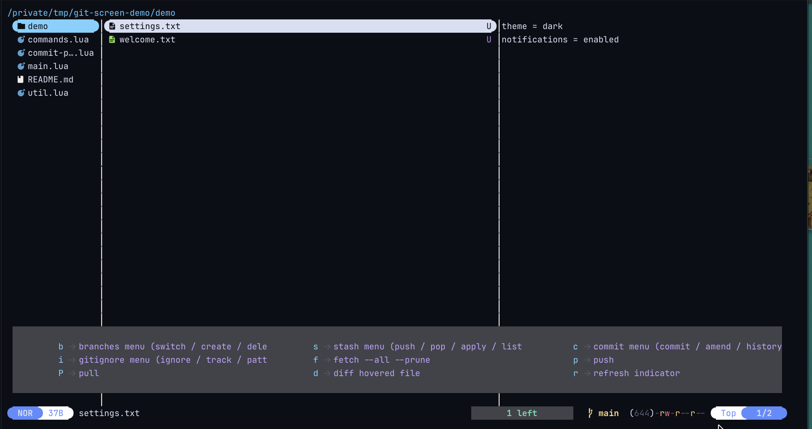
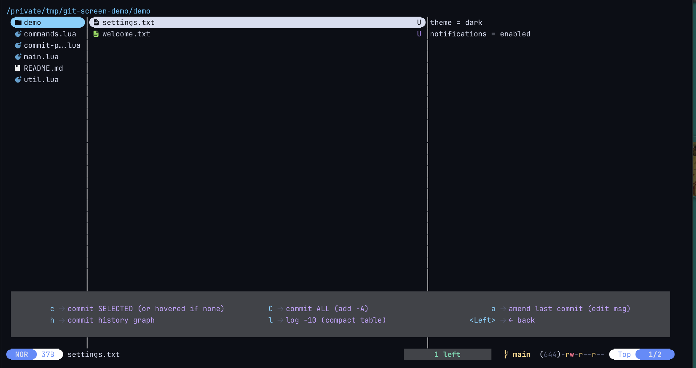
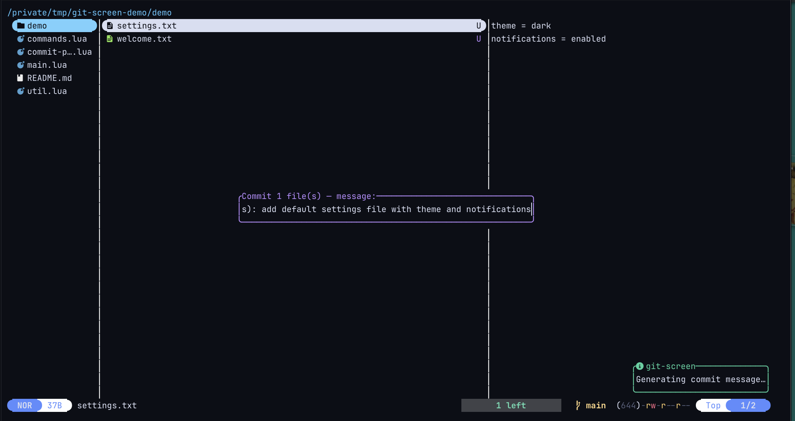
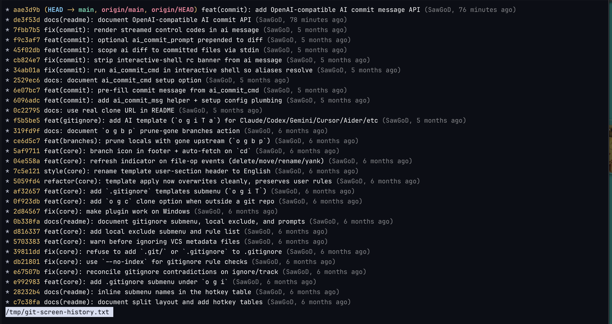

# git-screen.yazi

A [yazi](https://yazi-rs.github.io) plugin that turns the file manager into a
lightweight git client:

- **footer indicator** — current branch + `↑ahead ↓behind`, colored by state
  (green clean / yellow dirty / red conflict);
- **`o g` menu** — branch ops, stash, commit (selected / all / amend), history
  graph, fetch / push / pull, diff, init, and a full `.gitignore` / local
  exclude editor;
- **selection-aware** — `c` commits / `i` adds to .gitignore for the files
  marked with `<Space>` in yazi; falls back to the hovered file if nothing
  is selected;
- **auto-prompts** — when `git push` / `git pull` need a remote or upstream
  that isn't configured, an input popup asks for it instead of dumping git's
  hint text;
- **safe-by-default gitignore** — refuses to ignore `.git/` or `.gitignore`
  itself; warns before ignoring VCS metadata (`.gitattributes`, `.mailmap`,
  `.github`, `.gitlab`, `.gitmodules`); reconciles contradictions instead of
  appending them.

## Requirements

| Tool          | Required        | Notes                                              |
| ------------- | --------------- | -------------------------------------------------- |
| `yazi`        | **≥ 26.1**      | Uses `ui.render`, `pos = ...`, `ps.sub` APIs.      |
| `git`         | **required**    | Any modern version (≥ 2.30 recommended).           |
| `less`        | recommended     | Used for the commit graph / `log -10` viewer. Any `$PAGER` works. |
| `delta`       | optional        | Can be configured as `$PAGER` for viewing diffs and history. |
| `bash`        | required        | The history / push / pull viewers shell out via `bash`. |
| `curl`, `jq`  | optional        | Required for OpenAI-compatible HTTP API commit messages. |

No Lua dependencies — pure plugin code.

<details>
<summary>Screenshots</summary>


Open the Git menu with `o g`:



Choose `c` to open the commit menu:



When AI commit messages are configured, the generated subject is placed in
the input field for review before committing:



View the commit graph with `o g c h`:



</details>

## Installation

### 1. Drop the plugin into yazi's plugin dir

```bash
git clone https://github.com/SawGoD/git-screen.yazi.git ~/.config/yazi/plugins/git-screen.yazi
# OR copy the folder manually so the layout is:
#   ~/.config/yazi/plugins/git-screen.yazi/main.lua
```

### 2. Load the plugin from `init.lua`

Add the following line to `~/.config/yazi/init.lua` (create it if missing).
When configuring AI below, replace this call with the configured one; call
`setup` only once:

```lua
require("git-screen"):setup()
```

This is what attaches the footer indicator and subscribes to `cd` events.

#### AI commit messages (optional)

Pass `ai_commit_cmd` to have the commit message input pre-filled by a local
AI model. The command **reads the diff on stdin** and prints a commit message
to stdout:

```lua
require("git-screen"):setup {
  ai_commit_cmd = "ollama run qwen-msg",  -- reads diff from stdin
}
```

When you trigger **commit** (`o g c c` / `o g c C`), the plugin prepares a
diff scoped to the selected/hovered files or the whole tree, respectively,
including untracked files. It passes this diff on stdin and uses the first
nonempty output line to pre-fill the message field.

For a selected-file commit, Git also commits any changes that were already
staged outside the selection; those changes are not included in the selected
diff sent to the model. Review the index and generated message before
confirming. In a repository without an initial commit, tracked changes are not
included in the generated diff because there is no `HEAD` to compare against.

> **Important:** let the plugin produce the diff — don't run `git diff`
> inside your command. A command like `git diff | ollama run …` would describe
> the *whole repo* instead of just the files you're committing. Configure the
> bare model call (`ollama run qwen-msg`) and it receives the correctly-scoped
> diff on stdin.

If neither an API nor a command is configured, or the configured command
returns nothing, the field opens blank.

On Unix-like systems the command runs in an **interactive** shell (`$SHELL
-ic`), so aliases and functions from your shell's startup files can be used.
On Windows it runs through `cmd /c` instead.

#### OpenAI-compatible HTTP API

Alternatively, configure a Chat Completions endpoint directly. This requires
`curl` and `jq`. For DeepSeek, export `DEEPSEEK_API_KEY` in the environment
before starting yazi, and configure:

```lua
require("git-screen"):setup {
  ai_commit_api = {
    url = "https://api.deepseek.com/chat/completions",
    model = "deepseek-flash",
    api_key_env = "DEEPSEEK_API_KEY",
  },
  -- Optional: overrides the default commit-message instruction.
  -- ai_commit_prompt = "Write a short commit subject. Return only the subject.",
}
```

Use the full HTTPS Chat Completions URL, model name, and API key environment
variable for another OpenAI-compatible provider. If both `ai_commit_api` and
`ai_commit_cmd` are configured, the API takes precedence. The selected diff
and the two latest commit subjects are sent to the provider; API usage may
incur charges. The response is offered for review in the commit message field.
On failure the field opens empty and
an error notification is shown. The default system instruction is in
`commit-prompt.lua`; `ai_commit_prompt` overrides it.

#### Custom instructions (optional)

If your model doesn't already know the task (a raw model with no system
prompt), add `ai_commit_prompt` — it's prepended to the diff on stdin:

```lua
require("git-screen"):setup {
  ai_commit_cmd = "ollama run llama3",
  ai_commit_prompt = "Write one Conventional Commits line for this diff. "
    .. "Reply with the message only:",
}
```

For `ai_commit_cmd`, it's off by default, since prompt text is backend-specific and
many setups (e.g. an Ollama `Modelfile` with a baked-in `SYSTEM` prompt)
already carry their own instructions — leave it unset there. For the HTTP API,
the configured prompt replaces the default system instruction. Want the prompt
in a file? Read it yourself: `ai_commit_prompt = io.open(path):read("a")`.

> Note: the first call to a local model can take a few seconds to warm up —
> a "Generating commit message…" toast shows while it runs.

### 3. Wire the hotkey in `keymap.toml`

Add one binding under `[mgr] prepend_keymap` in `~/.config/yazi/keymap.toml`:

```toml
[mgr]
prepend_keymap = [
  { on = [ "o", "g" ], run = "plugin git-screen -- menu", desc = "Open git screen" },
]
```

That's the only keymap entry needed — all sub-actions live inside the
plugin's own picker.

### 4. (Optional) Make popup borders stand out

The plugin uses yazi's standard input popup. To recolor its border, edit
`~/.config/yazi/theme.toml`:

```toml
[input]
border = { fg = "magenta" }
```

### 5. Restart yazi

After restarting, navigate into any git repo — the footer should show the
branch indicator, and `o g` should open the menu.

## Usage cheatsheet

Open with `o g`. In any submenu, `←` returns to the parent. `Esc` closes
the menu entirely. Toasts only fire on explicit actions; navigation through
directories silently refreshes the footer indicator.

### Top-level menu (`o g`)

When the current directory is **not** a git repo:

| Key | Action                              |
| --- | ----------------------------------- |
| `i` | init repo here                      |
| `c` | clone repo here (input URL)         |

When inside a git repo, the full menu (with submenus) is shown below. `←`
always returns to the parent menu.

| Trigger | Sub             | Key | Action                                              |
| ------- | --------------- | --- | --------------------------------------------------- |
| `o g`   | `b · branches`  | `s` | switch branch (picker)                              |
|         |                 | `c` | create branch from current (input name)             |
|         |                 | `d` | delete local branch (-d)                            |
|         |                 | `D` | force-delete local branch (-D; unmerged)            |
|         |                 | `r` | delete REMOTE branch (push --delete)                |
|         |                 | `p` | prune locals whose upstream is gone (-d, safe)      |
|         |                 | `←` | back                                                |
|         | `s · stash`     | `s` | stash push -u (optional message)                    |
|         |                 | `p` | pop (latest, or pick if many)                       |
|         |                 | `a` | apply (latest, or pick if many)                     |
|         |                 | `l` | list (compact, in pager)                            |
|         |                 | `S` | show (diff of picked stash)                         |
|         |                 | `d` | drop (pick + confirm)                               |
|         |                 | `c` | clear ALL stashes (confirm; shows count)            |
|         |                 | `b` | branch from stash (pick + name input)               |
|         |                 | `←` | back                                                |
|         | `c · commit`    | `c` | commit SELECTED (Space-marked) or hovered           |
|         |                 | `C` | commit ALL (add -A)                                 |
|         |                 | `a` | amend last commit (msg pre-filled)                  |
|         |                 | `h` | commit-graph history (in pager)                     |
|         |                 | `l` | last 10 commits (compact table, in pager)           |
|         |                 | `←` | back                                                |
|         | `i · gitignore` | `i` | ignore SELECTED (Space-marked) or hovered           |
|         |                 | `t` | track (negate `!rule`) selected/hovered             |
|         |                 | `p` | pattern input (e.g. `*.log`, `build/`)              |
|         |                 | `l` | list .gitignore rules (in pager)                    |
|         |                 | `r` | remove rule (picker)                                |
|         |                 | `T` | open **templates** submenu (see below)              |
|         |                 | `x` | open **local exclude** submenu (see below)          |
|         |                 | `←` | back                                                |
|         | `f · fetch`     |     | git fetch --all --prune, notify and refresh         |
|         | `p · push`      |     | auto-prompts remote/upstream; handles rejected push |
|         | `P · pull`      |     | auto-prompts upstream; surfaces merge conflicts     |
|         | `d · diff`      |     | git diff of hovered file (in pager)                 |
|         | `r · refresh`   |     | force-refresh footer indicator                      |

### Templates submenu (`o g i T`)

Replaces `.gitignore` with a curated template — fully rewritten, clean and
predictable. Any rule the user had that **isn't** in the chosen template is
preserved verbatim and moved to a `# --- User rules (preserved by
git-screen) ---` section at the end. Existing comments are not preserved
(the template's own structure is used instead). Idempotent: applying the
same template twice leaves the file unchanged.

| Key | Template                                                  |
| --- | --------------------------------------------------------- |
| `b` | Basic — env / IDE / OS / logs / archives                  |
| `n` | Node.js — node_modules / dist / .next / coverage / …      |
| `p` | Python — venv / __pycache__ / dist / pytest / mypy / …    |
| `r` | Rust — target / coverage / profraw / …                    |
| `g` | Go — bin / dist / coverage / .test / …                    |
| `a` | AI — Claude / Codex / Gemini / Cursor / Aider / Continue / Copilot / … |
| `←` | back to gitignore submenu                                 |

### Local exclude submenu (`o g i x`)

Operates on `.git/info/exclude` instead of `.gitignore`. Rules added here
never leave your machine — perfect for personal mess (editor swap files,
local scratch dirs, etc.) without committing them to the team's ignore
list. Same set of actions as the parent submenu:

| Key | Action                                                |
| --- | ----------------------------------------------------- |
| `i` | local ignore SELECTED/hovered                         |
| `t` | local track (negate `!rule`)                          |
| `p` | local pattern input                                   |
| `l` | list current local rules (in pager)                   |
| `r` | remove local rule (picker)                            |
| `←` | back to gitignore submenu                             |

### Confirmation prompts

Several actions follow up with a small `y` / `←` picker before doing
anything destructive or otherwise surprising:

| Where it fires                                              | Choices                                                              |
| ----------------------------------------------------------- | -------------------------------------------------------------------- |
| `o g s d` (drop stash)                                      | `y` drop · `←` cancel                                                |
| `o g s c` (clear ALL stashes)                               | `y` clear · `←` cancel                                               |
| ignore a tracked file                                       | `y` `git rm --cached` + add ignore · `←` skip                        |
| ignore VCS metadata (`.gitattributes`, `.mailmap`, `.github`, `.gitlab`, `.gitmodules`) | `y` yes anyway · `←` cancel |
| `o g i p` / `o g i x p` (pattern entered)                   | `i` add as ignore · `t` add as track (negate) · `←` cancel           |
| **push rejected (non-fast-forward)**                        | `p` `pull --rebase` + retry · `f` `push --force-with-lease` · `←` cancel |
| **pull → merge conflict**                                   | `a` `git merge --abort` · `←` keep conflicts to resolve manually     |

A few paths/patterns are hard-blocked from `.gitignore` and
`.git/info/exclude` with no override: `.git/` and anything under it, and
`.gitignore` itself. Toast: *refusing to touch ... in .gitignore*.

## Troubleshooting

- **Indicator doesn't appear.** Check that `require("git-screen"):setup()` is
  in `init.lua` and that the directory contains a `.git`.
- **Hotkey opens, nothing happens.** Look at `/tmp/git-screen.log` — the
  plugin writes a line per invocation/event.
- **`o g c l` shows file paths instead of commit data.** Yazi expands
  `%`-placeholders in shell commands; if you fork the plugin, escape `%` with
  `%%` (see the `sh_pct` helper in `util.lua`).
- **`attempt to yield from outside a coroutine`.** Don't add `--- @sync entry`
  to the plugin — `Command:output()` requires running in a coroutine.

## Layout

```
~/.config/yazi/plugins/git-screen.yazi/
├── main.lua        setup, entry router, menus (top + 5 submenus)
├── util.lua        state, helpers, footer renderer, ensure_remote
├── commit-prompt.lua default API commit message instruction
├── commands.lua    all git operations (init / branches / stash / commit / gitignore / sync)
└── README.md       this file
```

`main.lua` is the entry point yazi loads via `require("git-screen"):setup()`.
It pulls in helpers via `require("git-screen.util")` and
`require("git-screen.commands")`; the API also loads `commit-prompt.lua`.
Yazi's plugin loader maps dotted module
names to sibling files inside the plugin directory.

Both `util.lua` and `commands.lua` return plain tables — **not factories.**
Yazi rejects modules that return a function with `error converting Lua
function to table`. `commands.lua` imports util itself instead of receiving
it as an argument.
